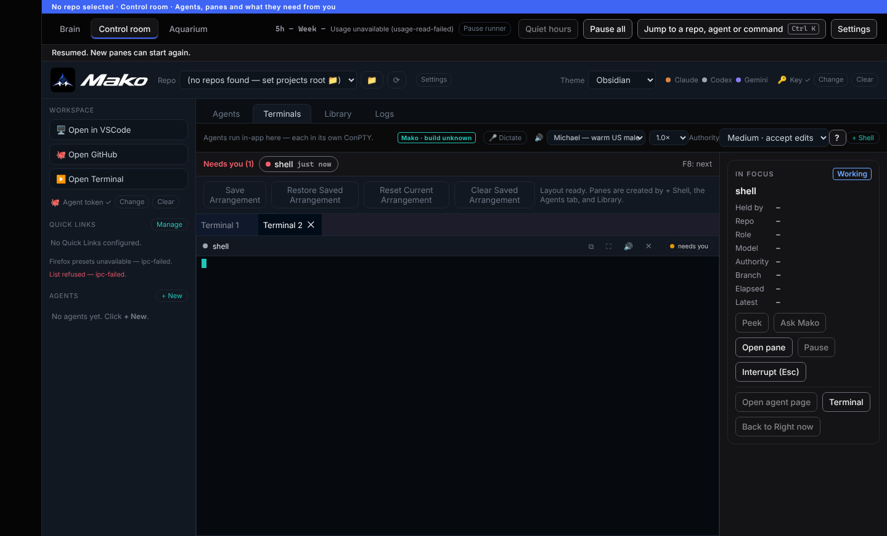

# The control room (S19)

Tab 2 of the three-tab layout (`docs/DESIGN-BRIEF-1.1.md` section 5), built on S66's shell. What
each piece does, and the signals it reads:

| Piece | What it does | Reads | Code |
|---|---|---|---|
| Needs you strip | One chip per pane waiting on you, oldest first, above the panes; a click focuses the pane | pane status `attention` | `app/renderer/needs-you-strip.js` |
| F8 jump key | Focuses the next waiting pane, oldest first; consumed before the terminal sees it | the strip | same, and S66's shortcut list |
| Taskbar badge | A red dot on Mako's taskbar button while any pane waits; its description gives the count (Windows only) | pane status in main | `app/needs-you-taskbar.js` |
| Toasts | Silent; held during quiet hours and shown when they end if the pane still waits | pane status, `uiQuietSince` | `app/pane-status/pane-status-notifications.js` |
| Pause all | One Esc to each working pane, once; nothing killed; waiting, idle and status-less panes untouched; new panes refused until Resume all, which sends nothing | pane status, S66's paused state | `app/renderer/pause-all.js` |
| Stall watch | "stalled" in the pane header after 20 minutes of silence while working, or 5 failed turns in a row; "waiting for reset at hh:mm" when a usage window is full | PTY output, pane status, S11's usage figures | `app/renderer/stall-watch.js` |
| Pane header tags | The branch, and for Claude panes the authority it started at (read-only for fenced roles) | the worktree list, the launch | `app/renderer/pane-header.js` |
| Right panel | S66's In-focus card for the selected pane; Open pane, Terminal and Interrupt (one Esc) are wired, the rest stay disabled with their reason | pane status | `app/renderer/control-focus.js` |
| Cheat sheet | The "?" button and a palette command list S66's one shortcut list; spoken phrases come with the Composer; sensitive phrases never appear | `SHORTCUTS` in `shell-nav.js` | `app/renderer/cheat-sheet.js` |

Builder's reading of the signals (no Blue decision behind them):

- "Needs you" is the pane status `attention` (Claude Code's `Notification` hook). Mako can't tell a
  permission prompt from another question (docs/NEEDS-YOU-ALERTS.md), so the right panel shows the
  question card for both.
- A "failed try" is a `failed` status (Claude Code's `StopFailure` hook). The count goes back to 0
  when a turn ends normally or the pane is idle.
- A usage stop is a 5-hour or weekly window at 100% or more with its reset still ahead.
- A status that only aged out (`unknown`, reason `stale`: no new hook event for 2 minutes,
  `app/pane-status/pane-status-freshness.js`) is not a change. Every piece above keeps the pane's last
  trusted state, as S05's toasts do. So a pane waiting on Blue stays in the strip and keeps the
  taskbar dot, and a pane working through a long tool call still gets Pause all's Esc. Any other
  `unknown` (no signal, hooks removed) ends it.
- Pause all and Interrupt request the Esc through `cc.ptyWrite`, a one-way message: main doesn't
  confirm delivery, so Logs and the notice say "requested". Panes with no Claude status are named,
  not interrupted.
- The 20-minute silence stall counts any PTY output as activity. Claude Code redraws its spinner
  while a turn runs, so a hung turn may never be 20 minutes silent (not verified; step 87 can't wait
  20 minutes). The 5-failed-turns stall doesn't depend on output.

## Pop-out windows: sized, left out of 1.1

Blue asked for pop-outs "if it makes sense to add now" (2026-11-16); the brief has S19 size them and
leave a seam (question 12). Sizing (builder's reading): a pop-out is a second `BrowserWindow` on the
same `index.html`. Every IPC handler in main accepts only the one trusted window
(`app/trusted-ipc-sender.js`), the navigation lockdown and the media-permission policy anchor on it
too, and `pty-data` is sent to that window only. A second window would need all of these to accept a
set of trusted windows, and the pane data to be routed to whichever window shows the pane. That
touches every sensitive boundary in main, so it is not cheap: it moves to the 1.2 queue.

The seam: `createShell` takes its `doc` and `win`, and everything S19 adds is keyed by pane id, not
by window or position, so one window can host any tab and a later pop-out can host one.

## Checked on Blue's PC

BLUE-CHECKLIST.md step 87. Windows CI runs the real renderer (`app/shell-nav-app-integration.test.js`)
with main stubbed and counts writes, starts and kills at the IPC boundary; it can't show the toast,
the taskbar dot or F8 against a live terminal.
