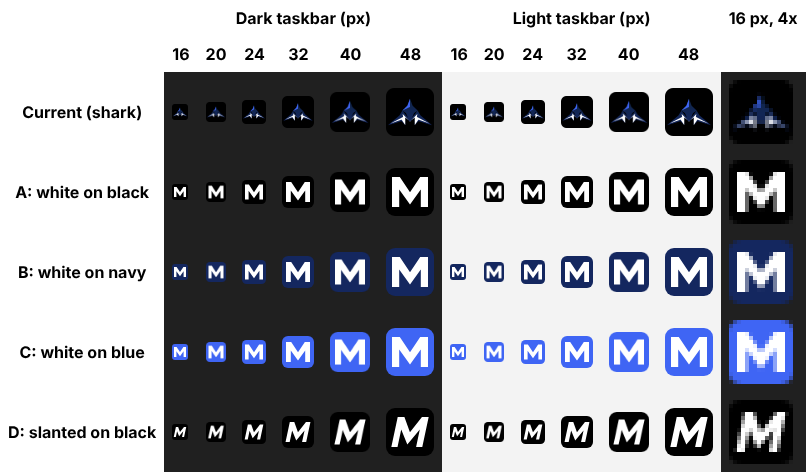

# Logo readability (S21)

Session S21 (docs/PLAN-1.1.md): "M" variants at 16 to 48 px; Blue picks; taskbar and shortcut icons
updated. Done when Blue can read the M on the taskbar.

## The problem

Mako's window and taskbar icon is `app/assets/mako.ico`, the approved shark mark
(`app/renderer/assets/mako-mark.svg`) on a black tile. At taskbar sizes (16 to 24 px at 100%
display scaling, 32 px at 200%) the shark shrinks to a few blue and white pixels, and on a dark
taskbar the black tile disappears into it. There is no letter to read.

## The candidates

Four "M" icons, in `app/assets/icon-variants/`. Each is a hand-drawn SVG (a block M on a
16-unit grid, so the 16, 32 and 48 px frames land on whole pixels) and a ready-made ICO with the
same seven PNG frames as today's `mako.ico` (16, 24, 32, 48, 64, 128, 256 px). The colours are the
shark's own: black tile, navy `#14275f`, accent blue `#3f65f4`.

| Variant | Look | Notes |
|---|---|---|
| A | White M on black | Closest to today's tile. Crisp, but the tile edge fades on a dark taskbar. |
| B | White M on navy | Keeps the shark's navy; the tile shows on both dark and light taskbars. |
| C | White M on accent blue | Brightest; stands out most on both taskbars. Recommended. |
| D | Slanted white M on black | Echoes the wordmark's italic m; the slant softens its edges at 16 px. |

The sheet shows each at 16, 20, 24, 32, 40 and 48 px on a dark (`#202020`) and a light
(`#f3f3f3`) background, plus the 16 px frame at 4x. 20 and 40 px have no frame of their own; they
are drawn from the next larger frame, as Windows does. It was rendered by Chromium in a Linux cloud
session, so it is close to, not identical with, what Windows draws; the real check is step 42 on
Blue's PC.

## What changes after Blue picks

Only the Windows icon: the picked ICO replaces `app/assets/mako.ico` (the file the window, and so
the taskbar button, already uses through `icon:` in `app/main.js`), and the hash pin in
`app/mako-branding.test.js` moves to it. The shark and wordmark in Mako's top bar stay as they are.
The desktop shortcut takes its icon from its own settings (`electron.exe,0` today), so Blue points
it at `app\assets\mako.ico` once (checklist step 42).

## Re-rendering

`node scripts/logo/render-icon-variants.js` (from the repo root) rebuilds every ICO from its SVG and
redraws the sheet. It needs Playwright with Chromium, which is not a Mako dependency; the script's
header says how to get it.
